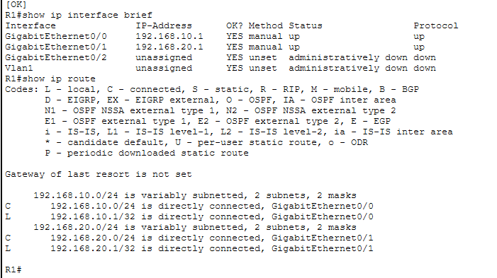

# Lab 1: Two LANs Connected by a Router (Cisco Packet Tracer)

[Leer en español](README.es.md)

**Labs:** Lab 1 (this page) · [Lab 2: DHCP](lab2-dhcp/README.md) · [Lab 3: Router security](lab3-seguridad/README.md) · [Lab 4: Wireshark](lab4-wireshark/README.md)

I designed and configured a network with two subnets connected by a Cisco 2911 router and two 2960 switches. I assigned static IP addresses to four PCs, configured the router interfaces as the default gateway for each network, and verified connectivity with `ping` and `show ip route`.

## Network diagram


## Addressing table

| Device | Network | IP address | Subnet mask | Default gateway |
|---|---|---|---|---|
| PC1 | 192.168.10.0/24 | 192.168.10.10 | 255.255.255.0 | 192.168.10.1 |
| PC2 | 192.168.10.0/24 | 192.168.10.11 | 255.255.255.0 | 192.168.10.1 |
| PC3 | 192.168.20.0/24 | 192.168.20.10 | 255.255.255.0 | 192.168.20.1 |
| PC4 | 192.168.20.0/24 | 192.168.20.11 | 255.255.255.0 | 192.168.20.1 |
| R1 Gi0/0 | 192.168.10.0/24 | 192.168.10.1 | 255.255.255.0 | N/A |
| R1 Gi0/1 | 192.168.20.0/24 | 192.168.20.1 | 255.255.255.0 | N/A |

## Router configuration

```
enable
configure terminal
hostname R1
interface gigabitEthernet0/0
 ip address 192.168.10.1 255.255.255.0
 no shutdown
 exit
interface gigabitEthernet0/1
 ip address 192.168.20.1 255.255.255.0
 no shutdown
 end
write memory
```

The switches run with their default configuration.

## Verification

- **Router interfaces and routing table** (`show ip interface brief` and `show ip route`): both interfaces are `up/up`, and both networks appear as directly connected (`C`).

  

- **Connectivity** from PC1: ping to PC2 (same network) and to PC3 (different network, through the router). TTL=127 confirms the packet crossed one router. The first packet is lost because of the initial ARP resolution.

  

## Tools and concepts

- Cisco Packet Tracer, Cisco IOS (CLI)
- IPv4 addressing, subnet mask, default gateway
- Routing between local networks
- Basic IOS commands: `enable`, `configure terminal`, `ip address`, `no shutdown`, `write memory`, `show ip route`

## Files

- `lab1-dos-redes.pkt`: lab file (open it with Cisco Packet Tracer)
- `diagrama-red.png`, `CLI.png`, `PING.png`: screenshots
