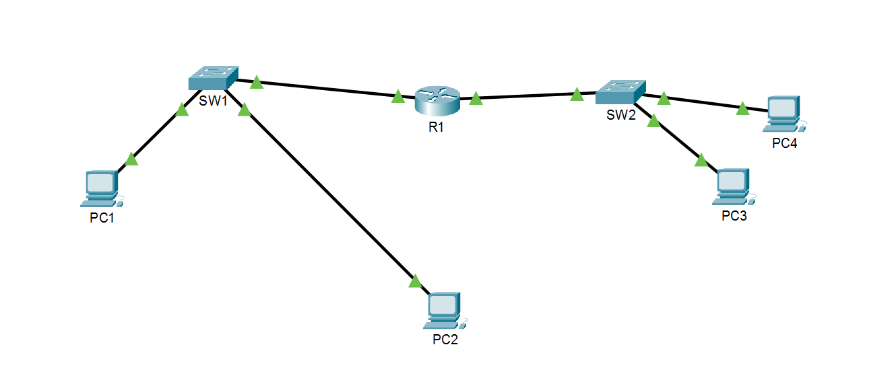
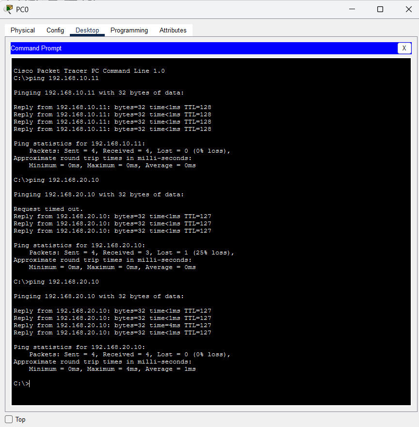

# Lab 1: Dos redes locales conectadas con un router (Cisco Packet Tracer)

Diseñé y configuré una red con dos subredes conectadas mediante un router Cisco 2911 y dos switches 2960. Asigné direcciones IP estáticas a cuatro PC, configuré las interfaces del router como gateway de cada red y verifiqué la conectividad con `ping` y `show ip route`.

## Diagrama



## Direccionamiento

| Dispositivo | Red | IP | Máscara | Gateway |
|---|---|---|---|---|
| PC1 | 192.168.10.0/24 | 192.168.10.10 | 255.255.255.0 | 192.168.10.1 |
| PC2 | 192.168.10.0/24 | 192.168.10.11 | 255.255.255.0 | 192.168.10.1 |
| PC3 | 192.168.20.0/24 | 192.168.20.10 | 255.255.255.0 | 192.168.20.1 |
| PC4 | 192.168.20.0/24 | 192.168.20.11 | 255.255.255.0 | 192.168.20.1 |
| R1 Gi0/0 | 192.168.10.0/24 | 192.168.10.1 | 255.255.255.0 | n/a |
| R1 Gi0/1 | 192.168.20.0/24 | 192.168.20.1 | 255.255.255.0 | n/a |

## Configuración del router

```
enable
configure terminal
hostname R1
interface gigabitEthernet0/0
 ip address 192.168.10.1 255.255.255.0
 no shutdown
 exit
interface gigabitEthernet0/1
 ip address 192.168.20.1 255.255.255.0
 no shutdown
 end
write memory
```

Los switches funcionan con su configuración por defecto.

## Verificación

- **Interfaces y rutas del router** (`show ip interface brief` y `show ip route`): las dos interfaces están `up/up` y las dos redes aparecen como conectadas (`C`).

  

- **Conectividad** desde PC1: ping a PC2 (misma red) y a PC3 (otra red, a través del router). El TTL=127 confirma que el paquete atravesó un router. El primer paquete se pierde por la resolución ARP inicial.

  

## Herramientas y conceptos

- Cisco Packet Tracer, Cisco IOS (CLI)
- Direccionamiento IPv4, máscara de subred, gateway
- Enrutamiento entre redes locales
- Comandos básicos de IOS: `enable`, `configure terminal`, `ip address`, `no shutdown`, `write memory`, `show ip route`

## Archivos

- `lab1-dos-redes.pkt`: archivo del laboratorio (se abre con Cisco Packet Tracer)
- `diagrama-red.png`, `CLI.png`, `PING.png`: capturas
