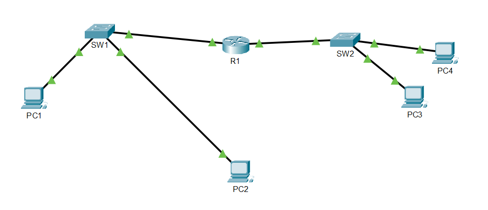
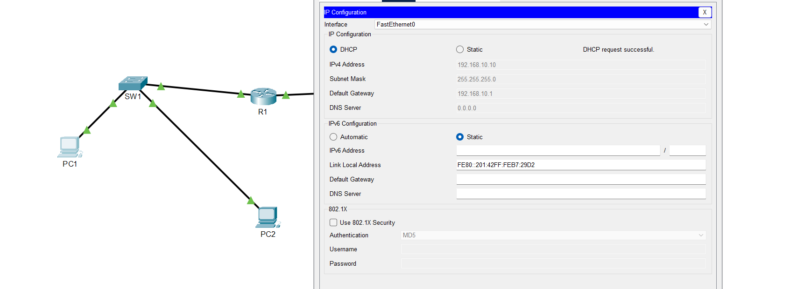
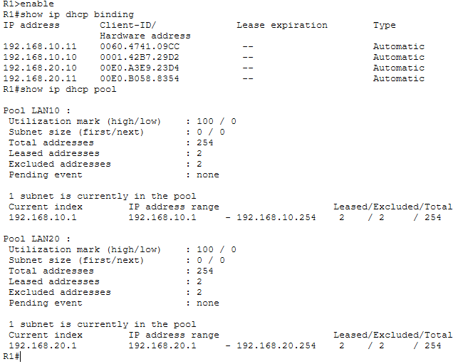
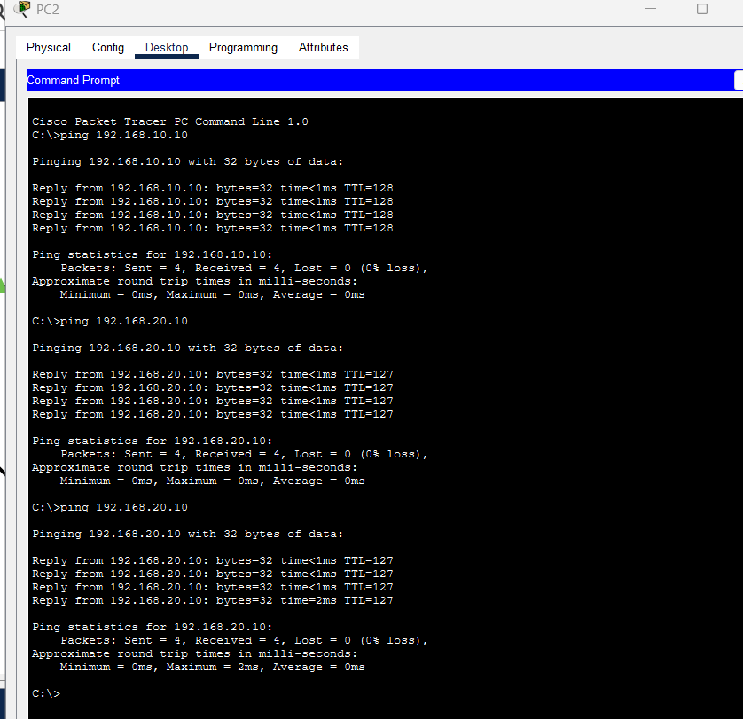

# Lab 2: DHCP en una red con dos LAN (Cisco Packet Tracer)

[Read in English](README.md)

A partir del [Lab 1](../README.es.md), configuré el router Cisco 2911 como servidor DHCP para las dos subredes. Los cuatro PC ahora reciben su dirección IP, máscara de subred y gateway de forma automática, en lugar de usar direcciones estáticas.

## Diagrama



## Diseño de DHCP

| Pool | Red | Gateway | Direcciones excluidas | Primera dirección entregada |
|---|---|---|---|---|
| LAN10 | 192.168.10.0/24 | 192.168.10.1 | 192.168.10.1 a 192.168.10.9 | 192.168.10.10 |
| LAN20 | 192.168.20.0/24 | 192.168.20.1 | 192.168.20.1 a 192.168.20.9 | 192.168.20.10 |

Las primeras nueve direcciones de cada red quedan reservadas para equipos de infraestructura, como el router.

## Configuración del router

```
enable
configure terminal
ip dhcp excluded-address 192.168.10.1 192.168.10.9
ip dhcp excluded-address 192.168.20.1 192.168.20.9
ip dhcp pool LAN10
 network 192.168.10.0 255.255.255.0
 default-router 192.168.10.1
 exit
ip dhcp pool LAN20
 network 192.168.20.0 255.255.255.0
 default-router 192.168.20.1
 end
write memory
```

En cada PC, la configuración IP se cambió de **Static** a **DHCP**.

## Verificación

- **Un PC recibiendo su dirección por DHCP** (`DHCP request successful`):

  

- **Asignaciones y pools DHCP en el router** (`show ip dhcp binding` y `show ip dhcp pool`). Los cuatro PC recibieron direcciones de los pools correctos:

  

- **Conectividad** desde PC2: ping a PC1 (misma red) y a PC3 (otra red, a través del router). El TTL=127 confirma que el paquete atravesó un router.

  

## Herramientas y conceptos

- Cisco Packet Tracer, Cisco IOS (CLI)
- Servidor DHCP en un router, pools de direcciones, direcciones excluidas
- Asignación de gateway por defecto
- Verificación con `show ip dhcp binding`, `show ip dhcp pool`, `ipconfig` y `ping`

## Archivos

- `lab2-dhcp.pkt`: archivo del laboratorio (se abre con Cisco Packet Tracer)
- `diagrama-red.png`, `dhcp-pc.png`, `dhcp-router.png`, `ping.png`: capturas
