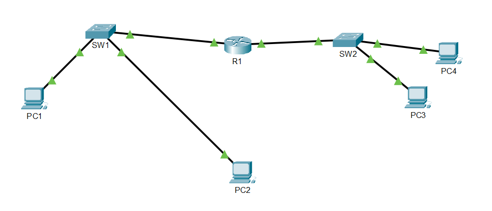
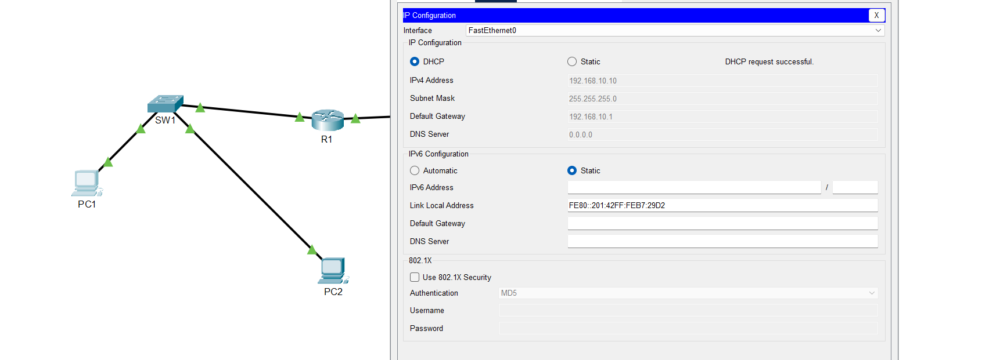
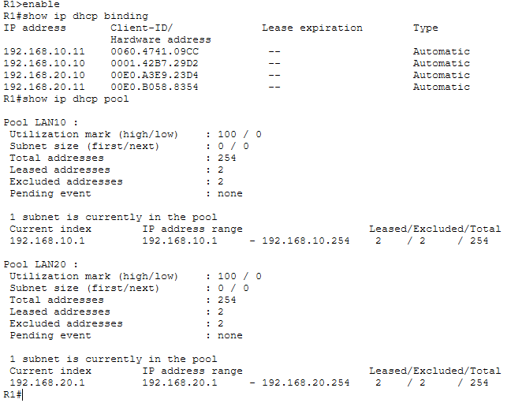
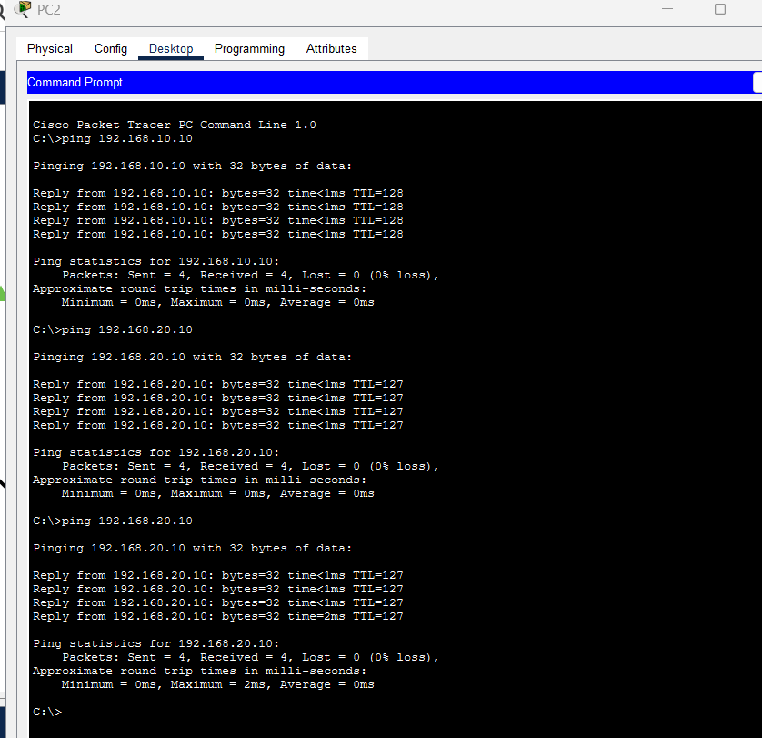

# Lab 2: DHCP on a Two-LAN Network (Cisco Packet Tracer)

[Leer en español](README.es.md)

Starting from [Lab 1](../README.md), I configured the Cisco 2911 router as a DHCP server for both subnets. The four PCs now receive their IP address, subnet mask and default gateway automatically instead of using static addresses.

## Network diagram



## DHCP design

| Pool | Network | Default gateway | Excluded addresses | First address leased |
|---|---|---|---|---|
| LAN10 | 192.168.10.0/24 | 192.168.10.1 | 192.168.10.1 to 192.168.10.9 | 192.168.10.10 |
| LAN20 | 192.168.20.0/24 | 192.168.20.1 | 192.168.20.1 to 192.168.20.9 | 192.168.20.10 |

The first nine addresses of each network are reserved for infrastructure devices such as the router.

## Router configuration

```
enable
configure terminal
ip dhcp excluded-address 192.168.10.1 192.168.10.9
ip dhcp excluded-address 192.168.20.1 192.168.20.9
ip dhcp pool LAN10
 network 192.168.10.0 255.255.255.0
 default-router 192.168.10.1
 exit
ip dhcp pool LAN20
 network 192.168.20.0 255.255.255.0
 default-router 192.168.20.1
 end
write memory
```

On each PC, the IP configuration was changed from **Static** to **DHCP**.

## Verification

- **A PC receiving its address by DHCP** (`DHCP request successful`):

  

- **DHCP bindings and pools on the router** (`show ip dhcp binding` and `show ip dhcp pool`). The four PCs received addresses from the correct pools:

  

- **Connectivity** from PC2: ping to PC1 (same network) and to PC3 (different network, through the router). TTL=127 confirms the packet crossed one router.

  

## Tools and concepts

- Cisco Packet Tracer, Cisco IOS (CLI)
- DHCP server on a router, address pools, excluded addresses
- Default gateway assignment
- Verification with `show ip dhcp binding`, `show ip dhcp pool`, `ipconfig` and `ping`

## Files

- `lab2-dhcp.pkt`: lab file (open it with Cisco Packet Tracer)
- `diagrama-red.png`, `dhcp-pc.png`, `dhcp-router.png`, `ping.png`: screenshots
