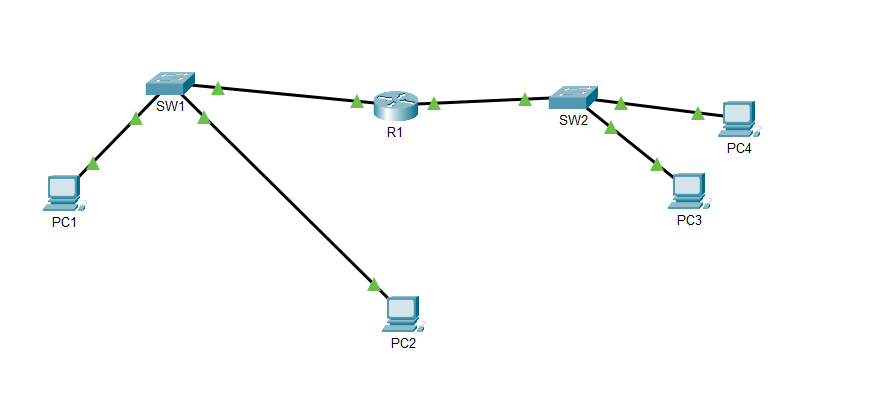
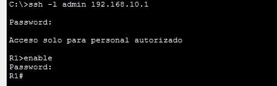
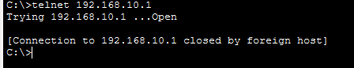
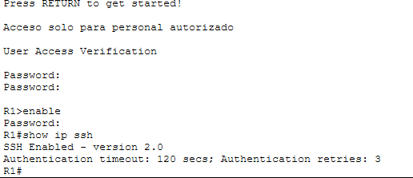

# Lab 3: Seguridad de un router con contraseñas y SSH (Cisco Packet Tracer)

[Read in English](README.md)

A partir del [Lab 2](../lab2-dhcp/README.es.md), reforcé la seguridad del router Cisco 2911 (R1) para que solo pueda administrarse por usuarios autenticados y mediante una conexión cifrada. Protegí el acceso por consola y el modo privilegiado con contraseñas, agregué un banner de aviso legal, creé una cuenta de administrador, habilité SSH versión 2 y bloqueé Telnet.

## Diagrama



La topología es la misma del Lab 2: un router, dos switches y cuatro PC en dos subredes (192.168.10.0/24 y 192.168.20.0/24).

## Medidas de seguridad

| Medida | Comando | Para qué sirve |
|---|---|---|
| Contraseña del modo privilegiado | `enable secret` | Solo usuarios autorizados pueden cambiar la configuración |
| Contraseña de consola | `line console 0` + `password` + `login` | Protege el acceso físico o por consola |
| Cifrado de contraseñas | `service password-encryption` | Las contraseñas no se leen en la configuración |
| Banner de aviso | `banner motd` | Aviso legal: acceso solo para personal autorizado |
| Cuenta de administrador | `username admin secret` | Cuenta individual en vez de una clave compartida |
| SSH versión 2 | `crypto key generate rsa` (1024 bits) + `ip ssh version 2` | Administración remota cifrada |
| Telnet bloqueado | `transport input ssh` | Telnet envía todo en texto plano, por eso se deshabilita |

## Configuración del router

Aquí las contraseñas están reemplazadas por marcadores. Usa tus propias contraseñas, largas y únicas.

```
enable
configure terminal
service password-encryption
enable secret <contraseña-enable>
line console 0
 password <contraseña-consola>
 login
 exit
banner motd #Acceso solo para personal autorizado#
ip domain-name lab.local
username admin secret <contraseña-admin>
crypto key generate rsa
 (modulus: 1024)
ip ssh version 2
line vty 0 4
 login local
 transport input ssh
 exit
end
write memory
```

El nombre `R1` y el nombre de dominio son necesarios para generar las claves RSA que usa SSH.

## Verificación

- **Acceso por SSH** desde PC1: `ssh -l admin 192.168.10.1`. El router muestra el banner, pide la contraseña y luego el modo privilegiado pide la suya.

  

- **Telnet bloqueado**: la conexión se abre y el router la cierra de inmediato, sin ofrecer pantalla de login.

  

- **Estado de SSH en el router** (`show ip ssh`): SSH habilitado en versión 2.0.

  

## Lo que aprendí

- Por qué Telnet es inseguro y por qué SSH protege la confidencialidad (la "C" de la tríada CIA).
- La diferencia entre las capas de autenticación: contraseña de consola, contraseña del modo privilegiado y cuenta de usuario.
- `enable secret` guarda un hash más fuerte que `service password-encryption`, que solo aplica un cifrado débil y reversible. Oculta las contraseñas a la vista, pero por sí solo no es una protección real.
- Este es un laboratorio con contraseñas de práctica. Un equipo real necesita credenciales fuertes y únicas, y su configuración nunca debe publicarse.

## Herramientas y conceptos

- Cisco Packet Tracer, Cisco IOS (CLI)
- Endurecimiento de dispositivos (hardening), autenticación, SSH, claves RSA
- Verificación con `ssh`, `telnet` y `show ip ssh`

## Archivos

- `lab3-seguridad.pkt`: archivo del laboratorio (se abre con Cisco Packet Tracer)
- `diagrama-red.png`, `ssh.png`, `telnet.png`, `show-ssh.png`: capturas
