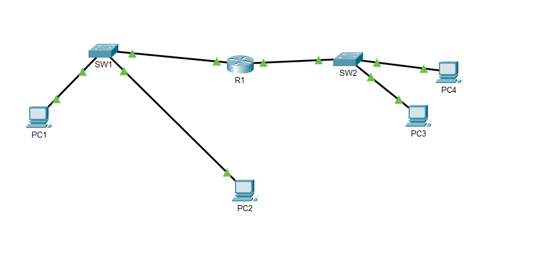
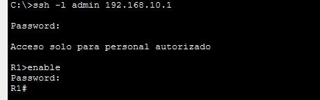
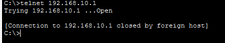
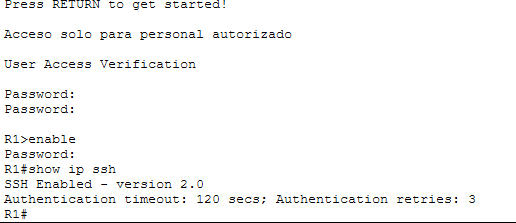

# Lab 3: Securing a Router with Passwords and SSH (Cisco Packet Tracer)

[Leer en español](README.es.md)

Starting from [Lab 2](../lab2-dhcp/README.md), I hardened the Cisco 2911 router (R1) so it can only be administered by authenticated users over an encrypted connection. I protected console and privileged access with passwords, added a legal warning banner, created an administrator account, enabled SSH version 2 and blocked Telnet.

## Network diagram



The topology is the same as in Lab 2: one router, two switches and four PCs on two subnets (192.168.10.0/24 and 192.168.20.0/24).

## Security measures

| Measure | Command | Purpose |
|---|---|---|
| Privileged mode password | `enable secret` | Only authorized users can change the configuration |
| Console password | `line console 0` + `password` + `login` | Protects physical/console access |
| Password encryption | `service password-encryption` | Passwords are not readable in the configuration |
| Warning banner | `banner motd` | Legal notice: access for authorized personnel only |
| Administrator account | `username admin secret` | Individual account instead of a shared password |
| SSH version 2 | `crypto key generate rsa` (1024 bits) + `ip ssh version 2` | Encrypted remote administration |
| Telnet blocked | `transport input ssh` | Telnet sends everything in plain text, so it is disabled |

## Router configuration

Passwords are replaced by placeholders here. Use your own strong, unique passwords.

```
enable
configure terminal
service password-encryption
enable secret <enable-password>
line console 0
 password <console-password>
 login
 exit
banner motd #Acceso solo para personal autorizado#
ip domain-name lab.local
username admin secret <admin-password>
crypto key generate rsa
 (modulus: 1024)
ip ssh version 2
line vty 0 4
 login local
 transport input ssh
 exit
end
write memory
```

The hostname `R1` and the domain name are required to generate the RSA keys that SSH uses.

## Verification

- **SSH access** from PC1: `ssh -l admin 192.168.10.1`. The router shows the banner, asks for the password, and then the privileged mode asks for its own password.

  

- **Telnet is blocked**: the connection opens and the router closes it immediately, without offering a login prompt.

  

- **SSH status on the router** (`show ip ssh`): SSH is enabled in version 2.0.

  

## What I learned

- Why Telnet is insecure and why SSH protects confidentiality (the "C" in the CIA triad).
- The difference between authentication layers: console password, privileged mode password and a user account.
- `enable secret` stores a stronger hash than `service password-encryption`, which only applies weak, reversible encryption. It hides passwords from casual viewing but is not real protection on its own.
- This is a lab with practice passwords. A real device needs strong, unique credentials, and its configuration should never be published.

## Tools and concepts

- Cisco Packet Tracer, Cisco IOS (CLI)
- Device hardening, authentication, SSH, RSA keys
- Verification with `ssh`, `telnet` and `show ip ssh`

## Files

- `lab3-seguridad.pkt`: lab file (open it with Cisco Packet Tracer)
- `diagrama-red.png`, `ssh.png`, `telnet.png`, `show-ssh.png`: screenshots
