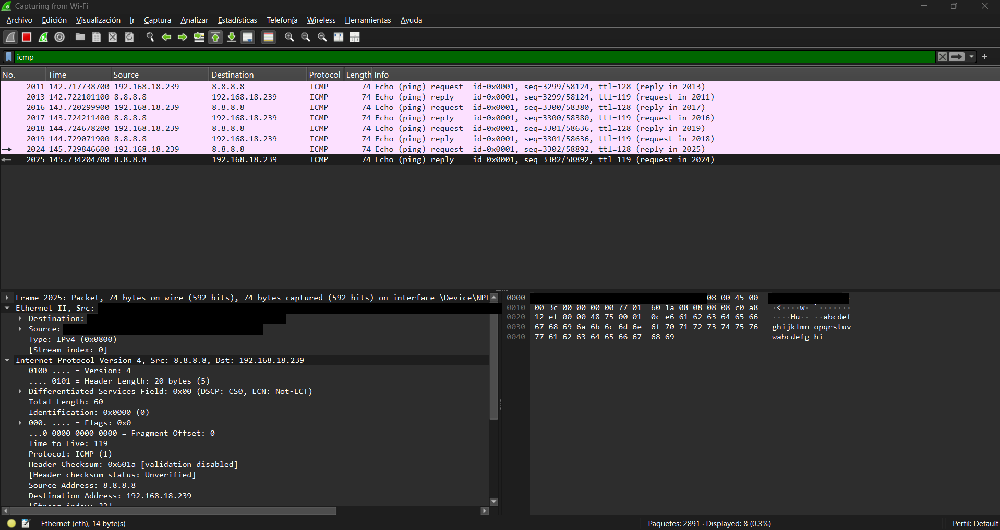
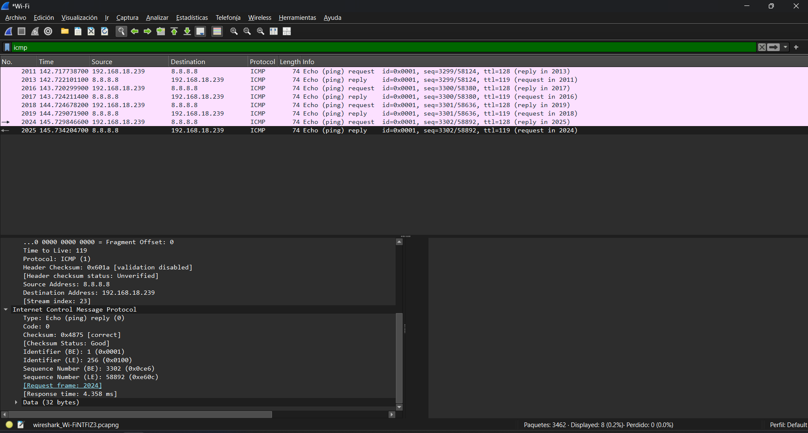
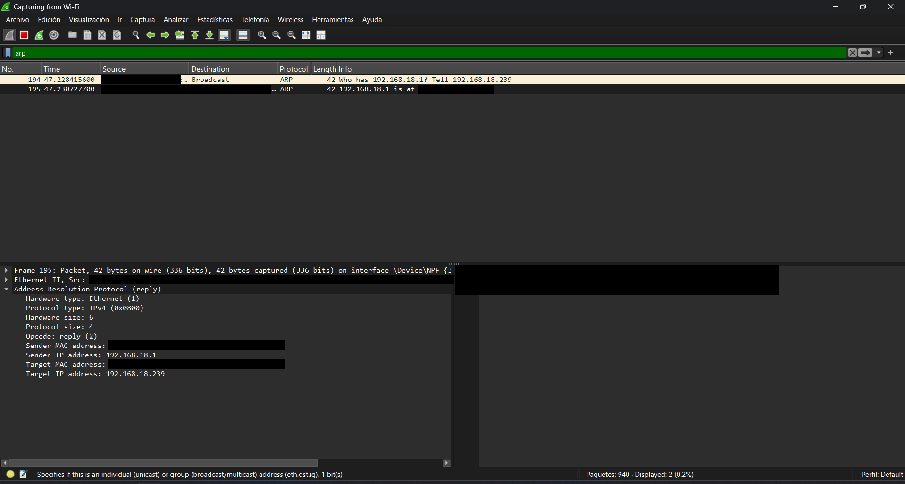
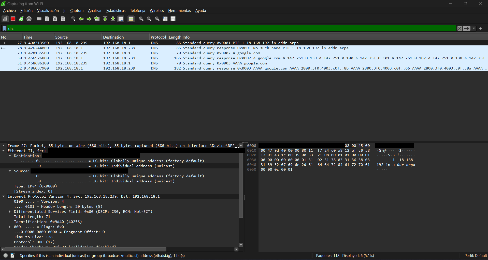
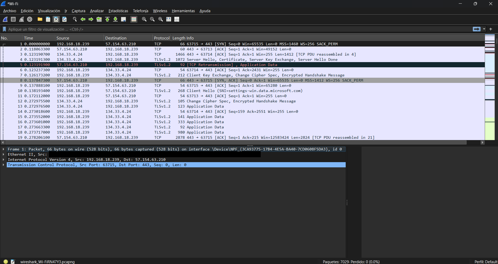

# Lab 4: Análisis de paquetes con Wireshark

[Read in English](README.md)

En los Labs 1 a 3 trabajé en Cisco Packet Tracer, donde el tráfico es simulado. En este laboratorio capturé **tráfico real de mi propio PC** por Wi-Fi con Wireshark y lo analicé capa por capa: ICMP (ping), ARP, DNS y una conexión TCP con TLS (HTTPS).

## Entorno

- Wireshark 4.6 con Npcap, en Windows, capturando en la interfaz Wi-Fi
- Red doméstica `192.168.18.0/24`: mi PC es `192.168.18.239` y el router es `192.168.18.1`
- Filtros de visualización usados: `icmp`, `arp`, `dns`

## Método

Para cada paquete respondí las mismas cuatro preguntas:

1. **Origen → Destino:** ¿quién habla con quién? ¿Cada IP es privada o pública?
2. **Protocolo:** ¿qué tipo de conversación es?
3. **Info:** ¿es una solicitud o una respuesta? ¿Qué puertos y banderas TCP aparecen?
4. **Capas:** ¿qué cabeceras lleva el paquete, desde Ethernet hasta la aplicación?

Después escribí una conclusión de una frase: quién hace qué, con quién y en qué etapa de la conversación.

## 1. Ping (ICMP)

Ejecuté `ping 8.8.8.8` con el filtro `icmp`. Wireshark mostró 8 paquetes: 4 Echo request y 4 Echo reply.

- Cada respuesta coincide con su solicitud por el **número de secuencia** (`seq=3299` a `3302`).
- **Tiempo de respuesta: 4,358 ms.** Wireshark enlaza cada respuesta con su solicitud.
- **TTL:** 128 en mis solicitudes (valor por defecto de Windows) y 119 en las respuestas, porque el TTL baja en 1 en cada router del camino de vuelta.
- **Capas:** Ethernet II → IPv4 → ICMP. ICMP no tiene puertos, porque no es TCP ni UDP.
- La trama mide **74 bytes**: 14 (Ethernet) + 60 (IP, que son 20 de cabecera + 40 de ICMP). Las capas suman.

**Conclusión:** mi PC hace ping al servidor DNS de Google y recibe respuesta en unos 4 ms.

## 2. ARP

Borré la tabla ARP con `arp -d *` y luego ejecuté `ping 192.168.18.1` con el filtro `arp`.

| Paquete | Mensaje | Significado |
|---|---|---|
| Solicitud | `Who has 192.168.18.1? Tell 192.168.18.239` | Enviada a la MAC de **broadcast** `ff:ff:ff:ff:ff:ff`, así que la reciben todos los dispositivos de la red |
| Respuesta | `192.168.18.1 is at <MAC del router>` | El router responde solo a mi PC (unicast) |

- ARP traduce una **dirección IP en una dirección MAC**. Mi PC conocía la IP del router, pero necesitaba su MAC para armar la trama Ethernet.
- El opcode 1 es una solicitud y el opcode 2 es una respuesta.
- ARP no usa capa IP: va directamente dentro de Ethernet (tipo `0x0806`).

**Conclusión:** mi PC pregunta a toda la red quién tiene la IP del router, y el router responde con su dirección MAC.

## 3. DNS

Ejecuté `nslookup google.com` con el filtro `dns`.

| Paquetes | Consulta | Resultado |
|---|---|---|
| 27 → 28 | **PTR** `1.18.168.192.in-addr.arpa` | *No such name* (consulta inversa de mi router, que no tiene nombre) |
| 29 → 30 | **A** `google.com` | Varias direcciones IPv4 (`142.251.0.x`) |
| 31 → 32 | **AAAA** `google.com` | Varias direcciones IPv6 (`2800:3f0:4003:c0f::...`) |

- DNS usa **UDP, puerto 53**. No hay saludo de conexión.
- Mi PC le pregunta al router, y el router resuelve el nombre por mí.
- Un registro **A** devuelve IPv4 y un registro **AAAA** devuelve IPv6.

**Conclusión:** mi PC le pide al servidor DNS las direcciones IP de un nombre y recibe respuestas IPv4 e IPv6.

## 4. TCP y TLS (HTTPS)

Capturé el tráfico normal de fondo de mi PC, que incluye conexiones HTTPS por el puerto **443**.

**Saludo de tres pasos** con `57.154.63.210` (paquetes 1, 8 y 9):

| Paquete | Emisor | Bandera | Significado |
|---|---|---|---|
| 1 | Mi PC | `SYN` | "Quiero abrir una conexión" |
| 8 | Servidor | `SYN, ACK` | "Acepto, abramos" |
| 9 | Mi PC | `ACK` | "Confirmado" |

Luego el paquete 10 es un **TLS Client Hello** con `SNI = settings-win.data.microsoft.com`: mi PC inicia una sesión cifrada con un servicio de Microsoft.

**Saludo TLS** con `134.33.4.24`:

- **Segmentación:** el primer mensaje del servidor era demasiado grande para un solo paquete. El paquete 3 lleva 1412 bytes y muestra `[TCP PDU reassembled in 4]`. El paquete 4 completa el mensaje (`Server Hello, Certificate, Server Key Exchange`).
- **Número de ACK:** en el paquete 6 mi PC responde `Ack=2431`. Eso confirma que recibió 2430 bytes (1412 + el resto del paquete 4). Un ACK del saludo tiene `Ack=1`, y un ACK de datos tiene un número mayor.
- **Change Cipher Spec:** el servidor avisa que desde ese momento todo va cifrado.
- **Application Data:** los datos reales viajan cifrados y su contenido no se puede leer.

**Conclusión:** mi PC abre una conexión TCP, negocia el cifrado con TLS y luego intercambia datos que Wireshark no puede leer.

## Encapsulación vista en paquetes reales

| Línea en Wireshark | Capa OSI | Ejemplo de mis capturas |
|---|---|---|
| Frame | 1. Física | 74 bytes en un ping |
| Ethernet II | 2. Enlace de datos | Direcciones MAC de origen y destino |
| Internet Protocol Version 4 | 3. Red | `192.168.18.239` → `8.8.8.8` |
| TCP / UDP / ICMP | 4. Transporte | Puerto TCP 443, puerto UDP 53 |
| DNS / TLS | 5 a 7. Aplicación | Consulta DNS, TLS Client Hello |

## Lo que aprendí

- Wireshark muestra las capas de abajo hacia arriba, igual que funciona la encapsulación en el modelo OSI.
- La dirección **MAC** cambia en cada salto, mientras que la dirección **IP** se mantiene de extremo a extremo.
- ARP usa broadcast para encontrar una MAC, y DNS usa UDP puerto 53.
- Una conexión TCP se abre con SYN, SYN-ACK y ACK, y el número `Ack` indica cuántos bytes se recibieron.
- Los mensajes grandes se dividen en varios segmentos TCP, y Wireshark los reensambla para poder leerlos.
- El tráfico HTTPS muestra quién habla con quién y cuándo, pero no el contenido. Eso es útil para un analista y también un límite de la herramienta.
- Leer una captura es un hábito paso a paso: origen y destino, protocolo, info, capas y una conclusión.

## Herramientas y conceptos

- Wireshark, Npcap, filtros de visualización
- Encapsulación, modelos OSI y TCP/IP
- ICMP, ARP, DNS, TCP, UDP, TLS
- `ping`, `nslookup`, `arp`

## Archivos

- `ping-ip.png`, `ping-icmp.png`, `arp.png`, `dns.png`, `tcp-tls.png`: capturas de pantalla

Los archivos de captura originales (`.pcapng`) no se publican porque contienen todo el tráfico de mi PC.
