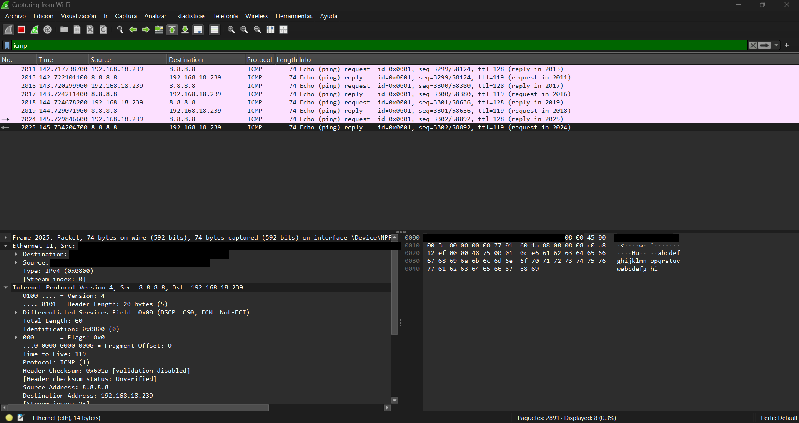
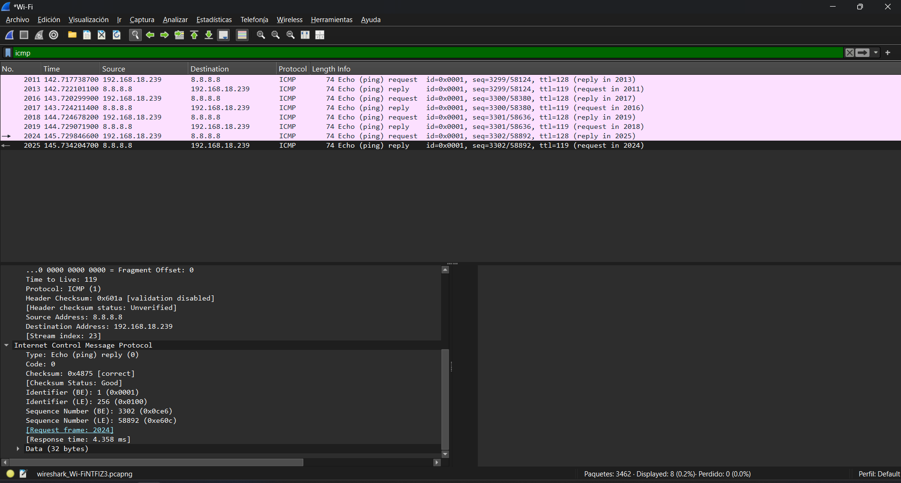
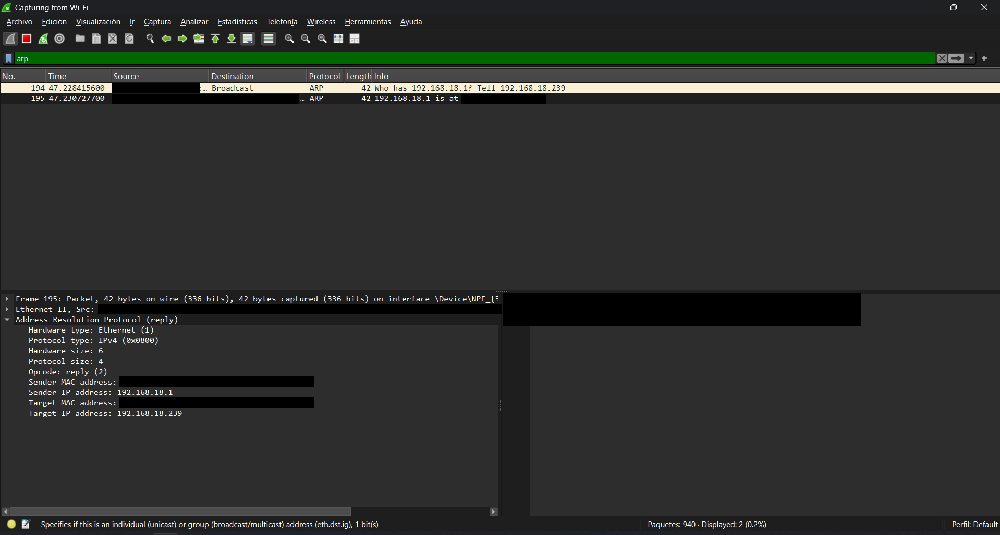
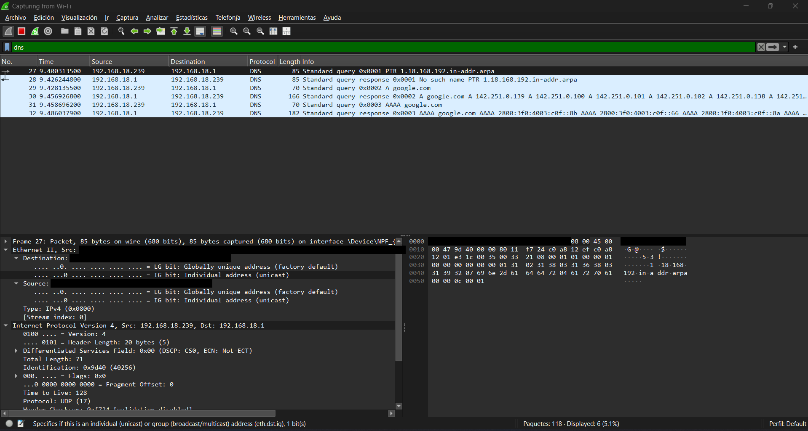
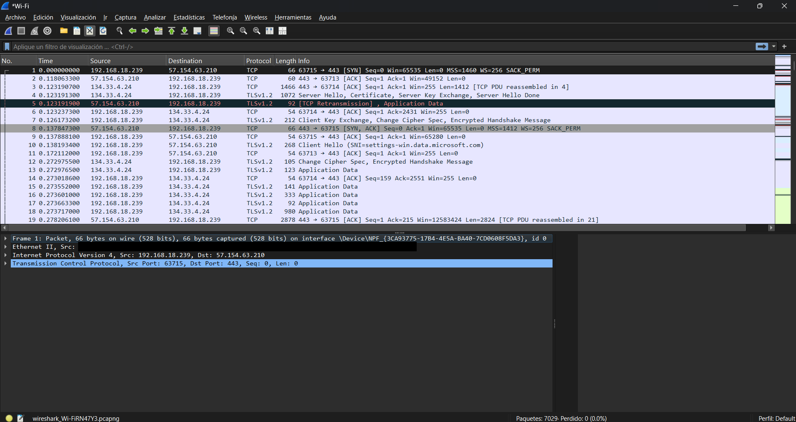

# Lab 4: Packet Analysis with Wireshark

[Leer en español](README.es.md)

In Labs 1 to 3 I worked in Cisco Packet Tracer, where traffic is simulated. In this lab I captured **real traffic from my own PC** over Wi-Fi with Wireshark and analyzed it layer by layer: ICMP (ping), ARP, DNS, and a TCP connection with TLS (HTTPS).

## Environment

- Wireshark 4.6 with Npcap, on Windows, capturing on the Wi-Fi interface
- Home network `192.168.18.0/24`: my PC is `192.168.18.239` and the router is `192.168.18.1`
- Display filters used: `icmp`, `arp`, `dns`

## Method

For every packet I answered the same four questions:

1. **Source → Destination:** who is talking to whom? Is each IP private or public?
2. **Protocol:** what kind of conversation is it?
3. **Info:** is it a request or a response? Which ports and TCP flags appear?
4. **Layers:** which headers does the packet carry, from Ethernet up to the application?

Then I wrote a one-sentence conclusion: who does what, with whom, and at which stage of the conversation.

## 1. Ping (ICMP)

I ran `ping 8.8.8.8` with the filter `icmp`. Wireshark showed 8 packets: 4 Echo requests and 4 Echo replies.

- Each reply matches its request by **sequence number** (`seq=3299` to `3302`).
- **Response time: 4.358 ms.** Wireshark links each reply to its request.
- **TTL:** 128 in my requests (Windows default) and 119 in the replies, because the TTL drops by 1 at every router on the way back.
- **Layers:** Ethernet II → IPv4 → ICMP. ICMP has no ports, because it is neither TCP nor UDP.
- The frame is **74 bytes**: 14 (Ethernet) + 60 (IP, which is 20 of header + 40 of ICMP). The layers add up.

**Conclusion:** my PC pings Google's DNS server and receives an answer in about 4 ms.

## 2. ARP

I cleared the ARP table with `arp -d *`, then ran `ping 192.168.18.1` with the filter `arp`.

| Packet | Message | Meaning |
|---|---|---|
| Request | `Who has 192.168.18.1? Tell 192.168.18.239` | Sent to the **broadcast** MAC `ff:ff:ff:ff:ff:ff`, so every device on the network receives it |
| Reply | `192.168.18.1 is at <router MAC>` | The router answers only to my PC (unicast) |

- ARP translates an **IP address into a MAC address**. My PC knew the router's IP but needed its MAC to build the Ethernet frame.
- Opcode 1 is a request and opcode 2 is a reply.
- ARP has no IP layer: it goes directly inside Ethernet (type `0x0806`).

**Conclusion:** my PC asks the whole network who owns the router's IP, and the router answers with its MAC address.

## 3. DNS

I ran `nslookup google.com` with the filter `dns`.

| Packets | Query | Result |
|---|---|---|
| 27 → 28 | **PTR** `1.18.168.192.in-addr.arpa` | *No such name* (reverse lookup of my router, which has no name) |
| 29 → 30 | **A** `google.com` | Several IPv4 addresses (`142.251.0.x`) |
| 31 → 32 | **AAAA** `google.com` | Several IPv6 addresses (`2800:3f0:4003:c0f::...`) |

- DNS runs over **UDP, port 53**. There is no connection handshake.
- My PC asks the router, and the router resolves the name for me.
- An **A** record returns IPv4 and an **AAAA** record returns IPv6.

**Conclusion:** my PC asks the DNS server for the IP addresses of a name and receives both IPv4 and IPv6 answers.

## 4. TCP and TLS (HTTPS)

I captured the normal background traffic of my PC, which includes HTTPS connections on port **443**.

**Three-way handshake** with `57.154.63.210` (packets 1, 8 and 9):

| Packet | Sender | Flag | Meaning |
|---|---|---|---|
| 1 | My PC | `SYN` | "I want to open a connection" |
| 8 | Server | `SYN, ACK` | "Accepted, let's open it" |
| 9 | My PC | `ACK` | "Confirmed" |

Then packet 10 is a **TLS Client Hello** with `SNI = settings-win.data.microsoft.com`: my PC starts an encrypted session with a Microsoft service.

**TLS handshake** with `134.33.4.24`:

- **Segmentation:** the server's first message was too large for one packet. Packet 3 carries 1412 bytes and shows `[TCP PDU reassembled in 4]`. Packet 4 completes the message (`Server Hello, Certificate, Server Key Exchange`).
- **ACK number:** in packet 6 my PC answers `Ack=2431`. This confirms that it received 2430 bytes (1412 + the rest of packet 4). A handshake ACK has `Ack=1`, while an ACK of data has a larger number.
- **Change Cipher Spec:** the server announces that from now on everything is encrypted.
- **Application Data:** real data travels encrypted, and its content cannot be read.

**Conclusion:** my PC opens a TCP connection, negotiates encryption with TLS, and then exchanges data that Wireshark cannot read.

## Encapsulation seen in real packets

| Wireshark line | OSI layer | Example from my captures |
|---|---|---|
| Frame | 1. Physical | 74 bytes for a ping |
| Ethernet II | 2. Data link | Source and destination MAC addresses |
| Internet Protocol Version 4 | 3. Network | `192.168.18.239` → `8.8.8.8` |
| TCP / UDP / ICMP | 4. Transport | TCP port 443, UDP port 53 |
| DNS / TLS | 5 to 7. Application | DNS query, TLS Client Hello |

## What I learned

- Wireshark shows the layers from the bottom up, exactly as encapsulation works in the OSI model.
- The **MAC** address changes at every hop, while the **IP** address stays the same end to end.
- ARP uses broadcast to find a MAC, and DNS uses UDP port 53.
- A TCP connection opens with SYN, SYN-ACK and ACK, and the `Ack` number tells how many bytes were received.
- Large messages are split into several TCP segments, and Wireshark reassembles them for reading.
- HTTPS traffic shows who talks to whom and when, but not the content. That is useful for an analyst, and also a limit of the tool.
- Reading a capture is a step-by-step habit: source and destination, protocol, info, layers, and a conclusion.

## Tools and concepts

- Wireshark, Npcap, display filters
- Encapsulation, OSI and TCP/IP models
- ICMP, ARP, DNS, TCP, UDP, TLS
- `ping`, `nslookup`, `arp`

## Files

- `ping-ip.png`, `ping-icmp.png`, `arp.png`, `dns.png`, `tcp-tls.png`: screenshots of the captures

The raw capture files (`.pcapng`) are not published because they contain all the traffic of my PC.
